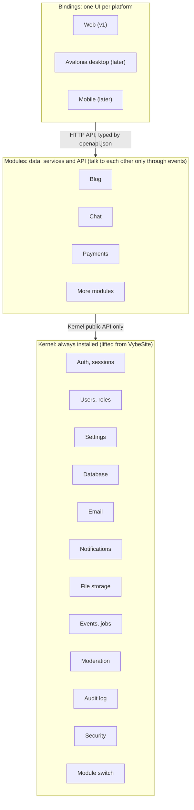
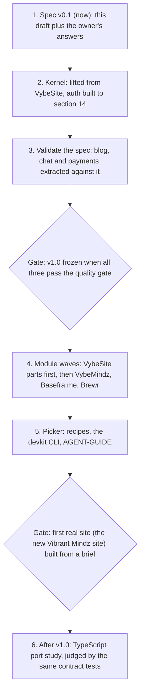

# AI DevKit Spec v0.1

Version 0.1 · 2026-11-12. From phase K0 on, this file is the source of truth. The design doc "AI DevKit Spec v0.1" (https://claude.ai/artifact/KtR3Cv8p5Fgr9fxRth6u81) is the owner's reading copy: every change here gets a decision record in `docs/decisions/`, a line in the change log at the bottom, and a note to the owner listing the sections to sync into the doc.

## 1. Purpose and scope

DevKit is a library of modules that any AI agent copies into a site's repo and wires together from a short brief. It exists to cut build time on the owner's own and client sites. It is not a hosted platform.

**In scope for v1:** websites, meaning a public site, a member area and an admin, built from one kernel plus modules.

**Later:** desktop (Avalonia) and mobile front ends over the same module APIs (section 18).

**Non-goals for v1**

- Not a WordPress-style CMS. Nothing is installed at runtime; modules are copied in at build time.
- Not a hosted backend. Baseframe stays a separate product.
- No marketplace and no third-party module authors.
- No code loaded from the database or from the network at runtime.

The words MUST, SHOULD and MAY are used as in RFC 2119.

## 2. Locked decisions and the v1 stack

The backend is Python, modules are copied in, and auth is homemade. These were locked on 2026-11-12. The inventory behind them is the project doc `devkit-inventory-and-stack-plan.md`.

| # | Decision | Why |
| --- | --- | --- |
| D1 | Backend in Python with FastAPI | About 19 existing backends, and VybeSite's hardened kernel, lift instead of being rewritten |
| D2 | Modules are copied into each site's repo, never installed as packages | This is a build tool for the owner and AI agents, not a CMS. Copied code can be customized freely |
| D3 | Homemade auth, owned by the kernel | No vendor lock-in, and full control of security behavior (section 14) |
| D4 | A TypeScript port is studied after v1.0 | v1 keeps every contract language-neutral so a port stays cheap (section 19) |

| Layer | v1 choice |
| --- | --- |
| Server language | Python 3.12+, typed (mypy strict on the kernel) |
| Web framework | FastAPI, Pydantic v2, pydantic-settings |
| Database | PostgreSQL 16+ via async SQLAlchemy 2 and asyncpg |
| Migrations | Alembic, one branch per module |
| Front end | React 19, Vite, TypeScript (strict) |
| Routing and data | React Router 7 (library mode), TanStack Query |
| Styling | Design tokens as CSS custom properties; Tailwind v4 mapped to the tokens |
| API types | Types from openapi-typescript and a client from openapi-fetch, both generated from FastAPI's OpenAPI schema |
| Realtime | FastAPI WebSockets; Redis pub/sub once a site runs more than one worker |
| Background jobs | Kernel worker and scheduler on a Postgres-backed queue, so no extra service |
| File storage | S3-compatible (Cloudflare R2) via boto3 |
| Email | One adapter: SMTP, Mailgun or Resend |
| Payments | Stripe |
| Deploy | Docker on Railway |
| Dependencies | uv-compiled, hash-pinned, with pip-audit floors (the VybeSite pattern) |
| Tests | pytest; Vitest with React Testing Library; Playwright |

## 3. Vocabulary

| Term | Meaning |
| --- | --- |
| Site | One project's repo, built from DevKit |
| Kernel | The always-installed core that every module depends on: auth, users, roles, settings, database, email, notifications, storage, events, jobs, moderation, security, module switches |
| Module | A folder copied into a site: a capability, one or more bindings and a manifest |
| Capability | A module's platform-neutral part: data, services, HTTP API, events |
| Binding | A module's UI for one platform. `web` in v1; `avalonia` and `mobile` later |
| Manifest | A module's `module.json`, which agents read to pick and install it |
| Recipe | A preset list of modules and settings for one kind of site |
| Theme | A token set: color, type, spacing, radius, motion |
| Slot | A named place in the kernel UI that a module can add to |
| Lock file | A site's `devkit.lock.json`: which kernel and module versions were copied, with file hashes |

## 4. Repository layout

DevKit is one repo of sources; a site is a separate repo that holds copies. Every module has the same fixed folders, so an agent always knows where things go.

**The DevKit repo**

```
devkit/
  AGENT-GUIDE.md          start here, for any AI
  AGENTS.md  CLAUDE.md    repo rules for agents (same content)
  SPEC.md                 this spec, versioned
  ADVISORIES.md           security advisories (section 13)
  catalog.json            generated from every module.json
  schema/                 JSON Schemas: module, recipe, lock file, events
  kernel/
    kernel.json
    backend/kernel/       auth, users, roles, settings, db, email, storage,
                          events, jobs, security, modules, crypto, audit,
                          notifications, moderation
    migrations/           Alembic branch "kernel"
    web/                  app shell, session hooks, API client, slots, UI kit
    tests/
  modules/<id>/
    module.json
    MODULE.md
    CHANGELOG.md
    backend/<id_>/        __init__.py models.py schemas.py service.py router.py   (<id_> = id with _ for -)
                          events.py jobs.py server_copy.py public.py
    migrations/           Alembic branch "<id>"
    openapi.json          generated and committed
    web/                  module.web.ts api.ts public.ts pages/ components/   (routes are defined in module.web.ts)
    tests/                backend/ web/ e2e/ contract/
  themes/<name>/          tokens.json tokens.css
  recipes/<name>.json
  templates/site/         the empty site every project starts from
  cli/                    devkit new | add | remove | check | diff | upgrade | catalog | create-owner
  docs/decisions/
```

**A site built from it**

```
<site>/
  devkit.lock.json
  CLAUDE.md  AGENTS.md
  backend/
    app/main.py           builds the app from the kernel and enabled modules
    app/site/             this site's own backend code
    kernel/               copied
    modules/<id>/         copied
    alembic/              env.py loads every branch
  web/
    src/kernel/           copied
    src/modules/<id>/     copied
    src/site/             this site's own pages and overrides
    src/theme/tokens.css
  Dockerfile  railway.toml
```

Code written for one site goes in `site/` folders. Copied folders MAY be edited, but `devkit check` reports every edit against the lock file (section 12).

DevKit itself lives at `C:\DEV\AI-DevKit`, in the GitHub repo `Vybecode-LTD/devkit`: public for now, the code still proprietary (decision 0011).

## 5. Module manifest (module.json)

Every module MUST ship a `module.json` that validates against `devkit/schema/module.schema.json`. Agents pick modules from `use_when` and `avoid_when`; the CLI installs from the rest.

| Field | Type | Rule |
| --- | --- | --- |
| `id` | string | Lowercase letters, digits and hyphens. Used as written for the route prefix and the Alembic branch; with hyphens turned into underscores for the table prefix and the Python package (`print-on-demand` becomes `print_on_demand`) |
| `name`, `summary` | string | `summary` is one line, 120 characters at most |
| `version` | semver | Section 13 |
| `status` | enum | `experimental`, `stable` or `deprecated` |
| `category` | enum | `content`, `community`, `comms`, `commerce`, `admin`, `media`, `security`, `ai` |
| `use_when`, `avoid_when` | string[] | Plain sentences an agent matches against the brief |
| `requires` | object | `kernel` range, plus `modules` as `{id: range}` |
| `conflicts` | string[] | Module ids that cannot be installed alongside |
| `permissions` | object[] | `{key, description, default_roles}`. Keys are `<id>.<resource>.<action>` |
| `settings` | object[] | `{key, type, default, secret, description}`: the summary an agent reads. The `Settings` model in `schemas.py` is the source of truth (section 7); `devkit check` fails a manifest that disagrees with it, and `secret` is true exactly for its `SecretStr` fields |
| `env` | object[] | `{name, required, description}` |
| `routes` | object | `api` prefix, plus `public`, `member` and `admin` paths |
| `tables` | string[] | Every table the module owns |
| `events` | object | `emits` and `listens`, by event name |
| `slots` | string[] | Kernel UI slots it fills (section 8) |
| `bindings` | string[] | `["web"]` in v1 |
| `jobs` | object[] | `{name, schedule}` for scheduled work |
| `notifications` | object[] | `{key, description, default}` for each kind of notice the module sends; default is in_site, email or both. The kernel builds each person's notification preferences from these |
| `data_hooks` | object | `export` and `delete` set to true when the module holds personal data. Required if any table references a user |
| `source` | object | Where the code was lifted from, the commit, and the license |

```json
{
  "id": "blog",
  "name": "Blog",
  "version": "0.1.0",
  "status": "experimental",
  "category": "content",
  "summary": "Posts with a rich editor, topics, related posts and optional AI drafting.",
  "use_when": ["The site publishes articles, news or updates", "The brief mentions SEO or content marketing"],
  "avoid_when": ["The site has a single static page", "Posts are really products; use shop instead"],
  "requires": {"kernel": "^0.1", "modules": {"media": "^0.1"}},
  "conflicts": [],
  "permissions": [
    {"key": "blog.post.write", "description": "Create and edit drafts", "default_roles": ["editor", "admin"]},
    {"key": "blog.post.publish", "description": "Publish and unpublish", "default_roles": ["admin"]}
  ],
  "settings": [{"key": "posts_per_page", "type": "int", "default": 10, "secret": false, "description": "Posts on each list page"}],
  "env": [],
  "routes": {"api": "/api/blog", "public": ["/blog", "/blog/:slug"], "member": [], "admin": ["/admin/blog"]},
  "tables": ["blog_post", "blog_topic", "blog_post_topic"],
  "events": {"emits": ["blog.post.published"], "listens": ["auth.user.deleted"]},
  "slots": ["nav.public", "nav.admin", "admin.dashboard.widget"],
  "bindings": ["web"],
  "jobs": [{"name": "publish_scheduled", "schedule": "*/5 * * * *"}],
  "notifications": [{"key": "blog.comment_reply", "description": "Someone replied under your post", "default": "both"}],
  "data_hooks": {"export": true, "delete": true},
  "source": {"from": "VybeSite", "commit": "TBD", "license": "proprietary"}
}
```

## 6. Kernel API contract

Modules MUST import only from the kernel's public surface: `kernel/__init__.py` on the backend and `kernel/web/index.ts` on the front end. Anything else in the kernel is private and may change in any release. The public surface follows semver.

**Backend (Python).** For modules. "Since" is the kernel phase that adds the name: anything marked K2 or later isn't in `kernel/__init__.py` yet.

| Name | Gives | Example | Since |
| --- | --- | --- | --- |
| `get_db` | An async SQLAlchemy session, one per request | `db: AsyncSession = Depends(get_db)` | K1 |
| `Base` | The declarative base every module's models subclass, with the kernel's naming convention | `class Post(Base): ...` | K1 |
| `public` | The access mark for a route anyone may call (section 7: every route declares its access) | `dependencies=[Depends(public)]` | K1 |
| `require_module(id)` | 404 while the module is switched off (VybeSite's `require_part`) | Added by the kernel to every module router | K1 |
| `settings.for_module(db, id)` | The module's typed, versioned settings | `cfg = await settings.for_module(db, "blog")` | K1 |
| `one_row_only(table)`, `for_saving(db, Model)` | A table that holds one row, and that row made safely on first save | A module's singleton config row | K1 |
| `rate_limit(rule, key=, scope=)` | Per-IP or per-account limits | `rate_limit("5/15m", key="account")` | K1 |
| `crypto.seal / open` | Encrypts secrets at rest, with key rotation (`ENCRYPTION_KEYS`) | Stored API keys for a third party | K1 |
| `Problem(code, status, detail)` | The one error shape (section 7) | `raise Problem("blog.post_not_found", 404)` | K1 |
| `current_user`, `optional_user` | The signed-in user, or 401 / `None` | `user: User = Depends(current_user)` | K2 |
| `require_permission(key)` | 403 unless the user holds the permission | `Depends(require_permission("blog.post.publish"))` | K2 |
| `require_owner_or(permission)` | The resource's owner, or staff holding the permission (14.8) | Editing your own comment | K2 |
| `require_recent_auth(minutes=10)` | Forces a fresh sign-in for sensitive actions | Changing a payout account | K2 |
| `email.send(template, to, context)` | Sends through the site's mail adapter | Welcome email | K3 |
| `storage.put / get / signed_url` | S3-compatible file storage | Uploads | K3 |
| `events.emit(name, payload)`, `@events.on(name)` | Durable events between modules (section 11) | `blog.post.published` | K3 |
| `jobs.enqueue(name, payload, run_at)`, `@jobs.scheduled(cron)` | Background and scheduled work | Scheduled publishing | K3 |
| `audit.record(actor, action, target, meta)` | An append-only audit entry | Role changed | K3 |
| `notify(user, key, context)` | An in-site and email notice, sent by the person's preferences for that key, with one-click unsubscribe | Someone replied to your comment | K3 |
| `moderation.report / queue / act` | Reports, the staff queue, word and link filters, and actions (hide, delete, time out, ban), all audited | A reported comment | K3 |
| `ai.client()` | The site's Anthropic client, when the AI part is on | AI drafting | K3 |

**Backend, for the site.** What a site's `backend/app` uses to build itself; modules don't need these.

| Name | Gives | Since |
| --- | --- | --- |
| `create_app(modules=, config=)` | The site's FastAPI app: the kernel, the modules, their routes, settings and CSP hosts | K1 |
| `Database(url)` | The engine and session factory `create_app` uses | K1 |
| `InstalledModule`, `Manifest` | A module as the app is built from it: its manifest, `router`, `Settings` and `CSP` | K1 |
| `__version__` | The kernel's version, which the public surface follows under semver | K1 |

**Front end (TypeScript)**

| Name | Gives |
| --- | --- |
| `useSession()` | The user, their roles, and `can(permission)` for showing or hiding UI |
| `api` and `useApiQuery` / `useApiMutation` | The generated, typed client wrapped in TanStack Query |
| `<RequireAuth>`, `<RequirePermission>` | Route guards |
| `useModuleEnabled(id)` | Whether a module is switched on |
| `useSettings(id)` | The module's settings, read-only on public pages |
| `defineModule({...})` | Registers routes and slots (section 8) |
| UI kit | Accordion, Dialog, form fields, Table, Toast, EmptyState, LoadError, SaveConflict, UnsavedDialog, Seo, mostly lifted from VybeSite |



Each platform's UI calls the same HTTP API, modules reach only the kernel's public surface, and auth is the kernel's core.

## 7. Backend rules

Routers stay thin, services hold the logic, and modules never reach into each other. The rules below are what `devkit check` and code review enforce.

**Files.** `models.py` (SQLAlchemy), `schemas.py` (Pydantic in and out), `service.py` (logic), `router.py` (HTTP). These are optional: `events.py`, `jobs.py`, `server_copy.py` (section 9) and `public.py` (what other modules may call). The kernel finds a module's parts by fixed names: `router.py`'s `router`, `schemas.py`'s `Settings` and `__init__.py`'s `CSP` (decision 0009).

**Routes**

- Mounted at `/api/<id>`, with admin routes under `/api/<id>/admin`.
- The kernel puts `require_module(id)` in front of every module router.
- Every route MUST declare its access: public, member or a permission. A test fails any route that declares none.
- Nothing changes state on GET.

**Between modules**

- A module MUST NOT import another module, except through that module's public surface: `public.py` on the backend and `web/public.ts` on the front end, and only when it is listed in `requires.modules`. This is how a blog post shows `<Comments>`.
- Everything else goes through kernel events.

**Errors.** One shape: RFC 9457 problem details (`application/problem+json`) with `type`, `title`, `status` and `detail`, plus a stable `code` such as `blog.post_not_found`. `type` is `urn:devkit:problem:<code>`, the same on every site. Field errors go in an `errors` map.

**Inputs and outputs**

- Every body is a Pydantic model in strict mode; no raw dicts.
- Lists use cursor pagination (`?cursor=&limit=`, at most 100) and return `{items, next_cursor}`.
- Ids are UUIDs. Times are `timestamptz` in UTC. Money is integer minor units plus an ISO 4217 currency code.

**Work and I/O**

- Async end to end. Blocking calls go through `run_in_threadpool`.
- Anything slower than about 1 second goes to `jobs`, never into the request.
- Outbound HTTP uses httpx with timeouts. User-supplied URLs pass the kernel's SSRF guard.

**Settings.** A module declares a Pydantic model, `Settings` in `schemas.py`, with a default for every field. The kernel stores it with version history and save-conflict checks (the VybeSite pattern). A field typed `SecretStr` (or `SecretStr | None`) is a secret: sealed at rest with `ENCRYPTION_KEYS` (MultiFernet, newest key first), never shown, never kept in a version. A secret anywhere else, such as in a list, a nested model or as `SecretBytes`, is refused when the module registers (decision 0009).

**Logs.** Structured JSON, never secrets, tokens or full email addresses.

## 8. Frontend rules and UI slots

A module's web binding registers its routes and slots through one `defineModule` call, styles itself only with theme tokens, and holds no business logic. That last rule is what lets desktop and mobile bindings reuse the same API later.

```ts
// modules/blog/web/module.web.ts
export default defineModule({
  id: "blog",
  routes: {
    public: [{ path: "/blog", lazy: () => import("./pages/BlogIndex") }],
    admin: [{ path: "/admin/blog", lazy: () => import("./pages/BlogAdmin"), permission: "blog.post.write" }],
  },
  slots: {
    "nav.public": [{ label: "Blog", to: "/blog" }],
    "admin.dashboard.widget": [{ lazy: () => import("./widgets/DraftsWidget") }],
  },
});
```

| Slot | What a module adds there |
| --- | --- |
| `nav.public` | A link in the public header or footer menu |
| `nav.member` | A link in the member area |
| `nav.admin` | An admin sidebar entry |
| `admin.dashboard.widget` | A dashboard card: scannable, one line of status, a link to the detail |
| `admin.settings.section` | A section on the admin Settings page |
| `account.section` | A section on the member's account page |
| `site.footer` | Footer content |

**Rules**

- Styling comes only from tokens (`var(--dk-*)`). Hard-coded colors fail lint. Tailwind v4's theme maps to the same tokens.
- Use the kernel UI kit before writing a new component. The admin shell is VybeSite's, as it stands.
- Data comes only through the generated client and TanStack Query; no `fetch` inside components.
- Every route is lazy-loaded, so a module that is switched off costs nothing in the bundle a visitor downloads.
- Forms guard unsaved changes and send a `version` for optimistic concurrency (VybeSite's SaveConflict).
- Accessibility: WCAG 2.2 AA, full keyboard use, focus moved on route change (VybeSite's RouteFocus).
- Admin screens follow the owner's lens: say what's wrong, why it matters and what to do; detail one click deeper in an accordion; a dashboard you can scan at a glance.

## 9. Public rendering, SEO and AI crawlers

Every public page MUST be readable without JavaScript, because GPTBot, ClaudeBot and PerplexityBot fetch pages but don't run their scripts; only Google's and Apple's crawlers render JS ([Vercel, Dec 2024](https://vercel.com/blog/the-rise-of-the-ai-crawler)). Python can't render React on the server, so DevKit uses VybeSite's server-copy pattern.

**What the server sends for each public URL** (VybeSite `site_routes.py` and `site_html.py`)

1. The page's own head tags: title, description, an absolute canonical, Open Graph and Twitter tags.
2. The page's words as plain semantic HTML inside the app's root, which React replaces on its first render.
3. Structured data (JSON-LD): Organization or LocalBusiness on the home page, BlogPosting for a post, FAQPage where a page has questions.
4. A real 404 for an address the site doesn't have, never a 200 shell.

**What a module with public routes provides** in `server_copy.py`

| Function | Returns |
| --- | --- |
| `head(path)` | The head tags, or `None` if the path isn't this module's |
| `copy(path)` | Escaped semantic HTML of the page's words: one `h1`, `h2` per section, no inline styles |
| `structured_data(path)` | JSON-LD objects |
| `sitemap()` | Every public URL with its last-modified time |

**Kernel-owned files.** `sitemap.xml`, `robots.txt` (AI crawlers allowed by default, switchable per site) and `llms.txt`.

**The known cost: two renderers.** The server copy and the React page describe the same content, so they can drift apart. Both MUST read the same rows. A Playwright test checks that every visible heading and paragraph on the rendered page also appears in the server copy. A TypeScript port would remove this cost (section 19).

## 10. Data rules and migrations

Each module owns its own tables and its own migration branch. It links only to the kernel's tables, never to another module's.

**Naming and ownership**

- One Postgres database per site.
- Tables are named `<module_id>_<name>` (hyphens become underscores). Kernel tables use `auth_` and `kernel_`.
- A module MAY have foreign keys to its own tables and to `auth_user`. It MUST NOT have foreign keys into another module's tables. It stores the id, and listens for the other module's delete event.

**Migrations**

- Each module's migrations form their own Alembic branch, labeled with the module id and depending on the kernel's branch.
- Every migration MUST downgrade cleanly. CI runs upgrade, downgrade, upgrade on an empty database and on seeded data.
- A migration that drops or rewrites data is marked `destructive = True` in its file, and the CLI asks before running it.
- Removing a module keeps its tables unless the owner runs `devkit remove <id> --drop-data`.

**Personal data**

- Any module whose tables reference a user MUST implement `export_user_data(user_id)` and `delete_user_data(user_id)`. The kernel calls these for account export and account deletion (section 14).
- Logs, events and other records that grow MUST declare a retention period. The kernel's retention job enforces it (VybeSite `retention_service.py`).

**Search.** Postgres full-text search in v1. A search module MAY add a dedicated engine later.

## 11. Events between modules

Modules talk to each other through durable events written in the same database transaction as the change. Handlers run afterward, in the worker, and MUST be safe to run twice.

**Names** are `<module>.<entity>.<past-tense verb>`, such as `auth.user.created`, `blog.post.published` or `payments.subscription.canceled`.

**Payloads** are Pydantic models declared in the emitting module's `events.py`. Each carries a version (`v`), holds ids rather than whole objects, and is exported as JSON Schema into `devkit/schema/events/`.

**Delivery**

1. `events.emit()` writes a row to `kernel_event_outbox` inside the caller's transaction.
2. After commit, the worker delivers it to every handler registered with `@events.on(name)`.
3. A failed handler retries with backoff. After 8 failures the event moves to a dead-letter list on the admin System page.
4. A handler is skipped while its module is switched off, and the event waits until the module is back on.

**Kernel events every module can listen to**

| Event | When |
| --- | --- |
| `auth.user.created` | An account is created by any method |
| `auth.user.verified` | The email address is confirmed |
| `auth.user.role_changed` | Roles are granted or removed |
| `auth.user.suspended` | Staff suspend an account |
| `auth.user.deleted` | Deletion completes; modules erase or anonymize that user's data |
| `kernel.module.enabled` / `kernel.module.disabled` | A module is switched on or off |
| `kernel.settings.changed` | A settings section is saved |

An outgoing-webhooks module MAY forward any event to outside URLs, signed with HMAC.

## 12. Module lifecycle

A module is copied in with `devkit add`, switched on and off at runtime, and upgraded by comparing against the lock file. Local edits are allowed but always visible.

**`devkit add <id>`**

1. Check `requires` and `conflicts` against the lock file. Stop on any conflict.
2. Copy the module's backend, migrations and web folders into the site.
3. Regenerate `backend/app/modules.py` and `web/src/modules.ts`, the two registries the app is built from.
4. Append its env vars to `.env.example` and print the ones still to set.
5. Record its version and every copied file's hash in `devkit.lock.json`.
6. Run its migrations (`alembic upgrade <id>@head`).
7. Run its tests and report the result.

**Switching on and off.** A module is on when the deploy's `MODULES` list allows it and the admin hasn't switched it off on the Features page (VybeSite's parts). While off, its routes answer 404, its slots are hidden, its jobs pause and its event handlers wait. A switch applies at once in the process that made it and within `MODULES_CACHE_SECONDS` (5 by default) in every other worker (decision 0009).

**`devkit remove <id>`.** Switch it off, offer an export of its data, delete its code and registry entries, and keep its tables unless `--drop-data` is given.

**Upgrades**

- `devkit diff <id>` compares three versions: the copy recorded in the lock file, the site's current files, and the latest DevKit version.
- `devkit upgrade <id>` applies the change when the site hasn't edited the module. Otherwise it writes a patch for an agent to merge.
- `devkit check` lists every edited file in copied folders, every module behind its latest version, and every open advisory.

**Customizing without editing.** Prefer settings, slots, event handlers and pages in `site/`. Edit copied files only when those can't do the job.

## 13. Versioning, the lock file and advisories

The kernel, each module and this spec carry their own semver. Because copies don't update themselves, security fixes travel as advisories that `devkit check` flags in every site.

**What counts as a major version**

- A breaking change to the kernel's public surface or a module's `public.py`.
- A migration that needs a manual step.
- An event payload that changes incompatibly; a new payload version is minor.

**The lock file**

```json
{
  "devkit": "0.1.0",
  "spec": "0.1",
  "kernel": {"version": "0.1.0", "files": {"backend/kernel/auth/sessions.py": "sha256:..."}},
  "modules": {
    "blog": {"version": "0.1.0", "added": "2026-11-20", "files": {"backend/modules/blog/service.py": "sha256:..."}}
  },
  "recipe": "local-business",
  "theme": "machined-light"
}
```

**Advisories.** `ADVISORIES.md` and `advisories.json` in DevKit list each security fix: an id, the affected module and versions, the fixed version, its severity and a one-line description. `devkit check` exits non-zero on any open advisory of high severity, so a site's CI fails until it is patched.

Every module keeps a `CHANGELOG.md`. A change to this spec is recorded in `docs/decisions/` before it lands.

## 14. Authentication and authorization

DevKit owns all of auth: the design, the data and the tests. It never hand-rolls crypto; hashing, TOTP, WebAuthn and OAuth use vetted libraries. Every rule below has a test in the auth contract suite (14.13).

**Lifted from:** VybeSite (sessions, sign-in codes, signed-in devices, Argon2id, password reset, the secret checks), Basefra.me (OAuth providers, CSRF, API keys, invites, its account-takeover fixes) and VybeMindz (session revocation, invite-only, per-resource permissions).

### 14.1 Accounts and roles

- One `auth_user` table for everyone; roles decide what an account is.
- Built-in roles are `owner` (every permission; at least one must exist), `admin`, `editor` and `member`. Sites may add custom roles.
- Staff means any account with a role other than `member`. Staff MUST have a second factor (14.4) before reaching the admin.
- Public sign-up creates only `member` accounts. Staff roles come from an owner or admin, or from an invite that names the role.
- **Who can grant what** (decision 0013): a role can be granted or removed only by someone who holds every permission it carries. Only an owner grants, removes or suspends an owner, and the last owner can't be removed, demoted or suspended. Built-in roles can't be deleted. The same rules bind invites.
- The first owner is made with `devkit create-owner`, or with a one-time setup token printed at first boot (VybeSite `setup_admin.py`).

### 14.2 Sign-in methods

| Method | v1 | Who |
| --- | --- | --- |
| Password | Yes | Everyone |
| Passkey (WebAuthn) | Yes | Everyone; the preferred method |
| OAuth / OpenID Connect: Google, Apple, Microsoft, GitHub, Discord | Yes | Everyone; each provider switched on per site |
| Email code or magic link | Yes | Members only, never as a second factor |
| SMS code | No | NIST lists SMS as a restricted authenticator (Q5) |

**Passwords**, following [NIST SP 800-63B-4](https://pages.nist.gov/800-63-4/sp800-63b/authenticators) section 3.1.1.2 and the [OWASP Password Storage Cheat Sheet](https://cheatsheetseries.owasp.org/cheatsheets/Password_Storage_Cheat_Sheet.html):

- Hashed with Argon2id (argon2-cffi), at least 19 MiB of memory, 2 iterations and parallelism 1, which is OWASP's minimum (`ARGON2_MEMORY_KIB`, `ARGON2_TIME_COST`, `ARGON2_LANES`). Setup benchmarks the host and raises memory where it can. Hashes are upgraded at sign-in when parameters rise. Hashing runs on a pool of its own, `ARGON2_CONCURRENCY` wide; a request that can't get a slot within 5 seconds answers 503 `kernel.busy` with `Retry-After` (decision 0014).
- At least 12 characters for every account, the owner's call (Q7). That is below NIST's 15 for a password used alone, so the blocklist below, the rate limits in 14.6 and passkeys offered first make up the gap. Staff always have a second factor, which puts them above NIST's 8. At least 64 characters are accepted; DevKit caps input at 256 to bound hashing cost.
- Unicode allowed and NFC-normalized, with each code point counted as one character.
- No composition rules, no forced rotation, no hints and no security questions.
- Checked against a bundled common-password list and the Pwned Passwords range API, where only the first 5 characters of the SHA-1 leave the server. If the API is down, the password is accepted and the miss is logged. A refused password is always explained.

**Passkeys.** The `webauthn` library, discoverable credentials, and user verification required when the passkey is the only factor. An account may hold several named passkeys, and any of them can serve as a second factor.

**OAuth and OpenID Connect** (Authlib as the client)

- Authorization code flow with PKCE (S256), a `state` tied to the browser session, and a `nonce` for OpenID providers.
- Redirect URIs match a per-site allowlist exactly.
- ID tokens are checked for issuer, audience, expiry, nonce and signature against the provider's published keys.
- Provider access tokens are not stored unless a module needs the provider's API. When stored, they are sealed.

**Email codes and magic links**

- Members only, and never a second factor. NIST forbids email as an out-of-band authenticator, so this counts as low-assurance convenience, like a password reset.
- A 6-digit code or a 32-byte link token, valid 10 minutes, single use, stored as a keyed hash (14.12). Five wrong tries end it. A resend waits at least 60 seconds.
- A link opens a confirm page, and only that page's POST signs in. Mail scanners that pre-open links can neither use them up nor sign anyone in.

### 14.3 Linking accounts without takeovers

- An outside identity is keyed by the provider plus the provider's subject id, never by email.
- A new provider identity links to an existing account automatically only when the provider says its email is verified and the existing account's email is verified too. Otherwise the person signs in the usual way first, then links from account settings.
- GitHub: only the verified primary email from its emails API counts. Apple: relay addresses are stored as given, and the name is saved at first sign-in because Apple sends it only then.
- Unlinking is allowed only while another sign-in method remains. Every link and unlink is audited and emailed.
- **No pre-claiming an address:** a provider link, a second factor or a passkey can be added only once the account's email is verified, so whoever signs up with someone else's address can't leave a way in for the real owner to inherit.

### 14.4 Second factors and step-up

- TOTP (RFC 6238, pyotp): 6 digits, 30-second steps, one step of drift either way, the secret sealed at rest, and a code refused if its step was already used.
- Recovery codes: 10 single-use codes, stored as keyed hashes and shown once. Making new ones voids the old.
- Passkeys count as a second factor.
- A second factor counts only once confirmed: a TOTP secret set up but never confirmed with a code is not one.
- Required for staff. Optional for members, unless the site's setting requires it.
- Step-up: changing email, password, second factors or passkeys, creating API keys, changing roles or payout details, and deleting the account all need a sign-in within the last 10 minutes (`require_recent_auth`).

### 14.5 Sessions

Web sessions are opaque random tokens kept in a cookie and checked against the database on every request, so any session can be ended instantly. No session token is ever readable by JavaScript.

- The token is 32 random bytes in the cookie `__Host-dk_session`, set HttpOnly, Secure, SameSite=Lax, Path=/. The database stores only its SHA-256.
- A new token is issued at sign-in, at step-up and on any role change, so a session can't be fixed in advance. Each session records the account's `role_version`; a role change raises it, the session's next request gets a new token, and the old one stops working.
- Each session records when it started, when it was last seen, the user agent, a device label and a coarse location. The account page lists them, with sign-out for each and "sign out everywhere else" (VybeSite `SignedInDevices`).
- `auth_user.session_epoch` goes up on a password change, a reset, a second-factor reset or a suspension, which ends every older session.
- CSRF: SameSite=Lax plus an Origin check on every request that changes state (VybeSite `same_origin.py`).
- **Known devices:** a browser that has signed in to an account keeps a signed, HttpOnly `__Host-dk_device` cookie naming that account. Over the account's failure limit (14.6), the right password still signs in on such a browser, so strangers' guesses can't lock an owner out. The cookie survives sign-out, is never the session, and helps no other account.
- Native and third-party clients (14.14) get short-lived access tokens and rotating refresh tokens instead. Reusing an old refresh token revokes the whole chain.

| Account | Idle timeout | Absolute limit |
| --- | --- | --- |
| Member | 14 days | 30 days |
| Staff | 8 hours | 7 days |

Both limits are site settings (Q6).

### 14.6 Abuse protection

| Action | Default limit |
| --- | --- |
| Password sign-in | 10 per IP per minute; after 5 failures on one account in 15 minutes, growing delays |
| Code or link sent | 3 per email per 15 minutes; 10 per IP per hour |
| Password reset request | Same as a code send |
| Sign-up | 5 per IP per hour |
| Second-factor check | 5 failures per sign-in, then the sign-in starts over |
| Step-up | 5 failures per session in 15 minutes, then the session ends |

- No permanent lockout, since that would let anyone lock out anyone. After 10 failures on one account in an hour, a Cloudflare Turnstile challenge MAY be added. NIST's ceiling is 100 consecutive failures; DevKit stays far below it.
- Sign-in, sign-up and reset give the same answer, in similar time, whether or not the account exists. A missing account, or a stored value that isn't an Argon2 hash, still costs one Argon2 verify, against a dummy made at start-up. A limit refused answers 429 `kernel.rate_limited` with `Retry-After`, the same for an account that exists and one that doesn't.
- Limits keyed on an email use the normalized address, so case variants share one budget.
- Sign-up with an address that already has an account sends that address a notice instead, and answers exactly as for a new one.
- Rate-limit windows run on real time, not on `kernel.clock`; expiries, the resend wait and the growing delays read `kernel.clock` (decision 0013).
- Security emails go out on a sign-in from a new device, a password change, an email change (to the old address, with an undo link valid 7 days), a second factor or passkey added or removed, an API key created and a provider linked.

### 14.7 Account lifecycle

- **Sign-up modes,** per site: open, invite-only or closed (VybeMindz `invite-only-access-control`). Invites are single use, expire in 7 days and may name a role.
- **Email verification** is required before posting public content or linking a provider. Unverified accounts are removed after 7 days.
- **Email change:** the new address confirms the change; the old one stays active until then and gets the undo link.
- **Password reset:** a 32-byte token, valid 30 minutes, single use, stored hashed. Success raises the session epoch and sends a security email.
- **Suspension:** staff only, audited, and it ends every session.
- **Deletion:** the person asks, with step-up. A 14-day grace period follows, and signing in cancels it. Then every module's `delete_user_data` runs and `auth.user.deleted` is emitted. The audit log keeps only a pseudonymous id.
- **Export:** a ZIP of JSON from every module's `export_user_data`, built as a job and sent as an expiring download link.

### 14.8 Authorization

- Permissions are strings, `<module>.<resource>.<action>`, declared in each manifest with default roles. Owners hold all of them. The kernel's own (`auth.*` and `kernel.*`) are declared in `kernel/kernel.json`, and a test holds the auth migration's seed to that list.
- Roles map to permission sets that staff can edit in the admin.
- Per-resource overrides grant or deny one permission on one thing, such as a single forum category (VybeMindz `per-resource-permission-overrides`), for one person or one role. A denial beats a grant, and a person's own override beats their role's.
- `require_owner_or(permission)` covers "your own, or staff with the permission".
- Deny by default. The server checks every time; the front end's `can()` only hides buttons.

### 14.9 API keys

- For machines only, never for people signing in.
- Format `dk_<live|test>_<8-character id>_<32-byte secret>`, shown once. Only the secret's SHA-256 is stored, which is enough for a random secret.
- Scoped to some of the creator's permissions, expiring after 90 days by default, recording last use, and revocable. A key acts with the permissions its scopes and its creator hold now, so a role removed narrows it, and a suspended or deleted creator's keys stop working.

### 14.10 Audit log

- `auth_audit_event` is append-only. It records sign-ins and failures, second-factor and passkey changes, password and email changes, provider links, role changes, ended sessions, API keys, suspensions and deletions.
- Each row holds the time, actor, subject, action, result, IP, user agent and details. Rows are kept 1 year by default.
- Staff see all of it. Each person sees their own security activity on the account page.

### 14.11 Tables

| Table | Holds |
| --- | --- |
| `auth_user` | Email, verified time, password hash, status, session epoch, timestamps |
| `auth_role`, `auth_user_role`, `auth_role_permission` | Roles and their grants |
| `auth_permission_override` | Per-resource grants and denials |
| `auth_identity` | Linked providers: provider, subject, email, verified flag |
| `auth_passkey` | Credential id, public key, sign count, name, last use |
| `auth_totp` | Sealed secret, last used step |
| `auth_recovery_code` | Keyed hashes of the codes, unique per person; used time |
| `auth_session` | Token hash, user, start, last seen, expiry, user agent and device details |
| `auth_token` | One-time tokens as keyed hashes: verification, reset, sign-in code, magic link, email change, invite. A 32-byte token is unique by its hash; a 6-digit code is found by its purpose and address |
| `auth_api_key` | Id, secret hash, scopes, expiry, last use |
| `auth_audit_event` | The audit log |

### 14.12 Crypto and secrets

- Random values come from Python's `secrets`, and every token check is a constant-time comparison.
- One-time tokens, sign-in codes and recovery codes are kept as HMAC-SHA256 under SECRET_KEY, over their purpose, owner and value (decision 0012). Session tokens and API-key secrets, 32 random bytes each, keep a plain SHA-256.
- Every foreign key has an index.
- Secrets at rest (TOTP secrets, stored provider tokens) are sealed by kernel crypto with MultiFernet, so keys rotate without downtime.
- Outside debug, the app refuses to start on a default, placeholder or short secret (VybeSite's check).

### 14.13 Contract tests

These run against the HTTP API, not Python internals, so the same suite can test a TypeScript port later (section 19). Each MUST exist before auth ships. The routes they call are written down in `docs/contracts/auth-api.md`; time, mail and outside providers are driven through the harness's test-support routes (decision 0010).

- [ ] Sign-in, sign-up and reset answer the same for a known and an unknown email
- [ ] A reset, code or link token works once, and never after it expires
- [ ] Opening a magic link with GET alone signs nobody in
- [ ] A TOTP code can't be replayed within its step
- [ ] Staff without a second factor can't reach any admin route
- [ ] Every action listed under step-up (14.4) demands it
- [ ] A password change ends every other session
- [ ] A provider identity with an unverified email never links automatically
- [ ] An OAuth callback with a wrong or missing `state` is refused
- [ ] A state-changing request from another origin is refused
- [ ] The session token changes at sign-in and on a role change
- [ ] Each rate limit in 14.6 triggers at its threshold
- [ ] A route with no declared access fails the route audit
- [ ] Deleting an account runs every module's delete hook

### 14.14 Later: desktop and mobile

- Native apps sign in with OAuth 2.0 for Native Apps (RFC 8252): the system browser, PKCE, and a loopback or claimed HTTPS redirect. The owner's `oauth-pkce-desktop` skill covers this.
- They receive the token pair from 14.5 instead of a cookie.

## 15. Security baseline beyond auth

The kernel sets these defaults for every site, and a module MUST NOT weaken them.

- **Headers:** a strict Content-Security-Policy with no inline script or style, HSTS, `frame-ancestors 'none'`, Referrer-Policy and Permissions-Policy (VybeSite `security_headers.py`).
- **Third-party hosts:** a module declares the https origins it needs (`CSP` in its `__init__.py`), each in one of `script-src`, `img-src`, `connect-src`, `frame-src`, `media-src`, `form-action` or `font-src`, and they join the policy only while the module is on, each with a test. `script-src` takes exact hosts, never a wildcard.
- **User HTML:** Markdown is rendered on the server, and any HTML is cleaned against an allowlist with nh3.
- **Uploads:** the type is checked from the file's bytes, images are re-encoded with Pillow and stripped of metadata, sizes are capped, and files live in object storage. Anything that isn't an image is served as a download.
- **Object storage:** private files are reached only through short-lived signed links. A file an outside provider must fetch, such as a print file, gets a public, unguessable link that expires with its job. Large files never go in Postgres.
- **Outbound requests:** private and link-local addresses are blocked for user-supplied URLs, and every call has a timeout.
- **Webhooks:** incoming ones are signature-checked with a replay window (Stripe's included). Outgoing ones are HMAC-signed.
- **Secrets:** environment variables only, never in the repo or in logs. gitleaks runs in CI.
- **Python dependencies:** compiled with uv, hash-pinned, and checked with pip-audit.
- **npm dependencies:** lockfile installs only, and `ignore-scripts=true` in `.npmrc`, since install scripts are how the 2025 npm worms spread. Each new package is justified in its PR.
- **Provenance:** every module records its source in `source`. Nothing from the client folder named in `docs/private/README.md` or other client-confidential material enters DevKit. VybeSite's private brand check runs on any code lifted from VybeSite before it lands.
- **Licenses:** DevKit is proprietary, and selected modules MAY be released under MIT. Each module states its license in `source`, and third-party code is listed in a NOTICE file.

## 16. Quality gate

A module is `stable` only when it passes every row below in CI. `devkit check` runs the same checks inside a site. CI runs on every pull request, every push to `main` and weekly (decision 0015). The end-to-end, accessibility, public-pages and tokens rows run from K4, when there are pages to run them on.

| Area | Bar | Tool |
| --- | --- | --- |
| Backend tests | Every service function and route, including each permission path; 85% line coverage of the module as the default floor | pytest, coverage |
| Contract tests | HTTP-level tests of the module's API that don't import its Python | pytest with httpx against the running app |
| Migrations | Upgrade, downgrade, upgrade on an empty and a seeded database | pytest |
| Front end | A component test for every page and widget | Vitest, React Testing Library |
| End to end | A smoke test for every public, member and admin route | Playwright |
| Types and lint | mypy strict, tsc strict, zero warnings from ruff and ESLint, Black formatting |  |
| Accessibility | No serious or critical violations on any page | axe via Playwright |
| Public pages | Server-copy test passes (section 9); title, description, one `h1`, canonical, JSON-LD | Playwright, the SEO gate |
| Security | Auth contract tests (14.13) when auth is touched; gitleaks, pip-audit, npm audit clean |  |
| Tokens | No hard-coded colors | Stylelint and ESLint rules |
| Docs | `module.json` validates; `MODULE.md` has every required section | `devkit check` |

## 17. The AI-facing layer

Any agent starts at `AGENT-GUIDE.md`, picks from `catalog.json` and recipes, and confirms its module list with the owner before copying anything. Everything it reads is plain Markdown and JSON, so the flow doesn't depend on Claude.

**The flow in `AGENT-GUIDE.md`**

1. Read the brief. Ask at most 3 questions, and only ones whose answers change the module list: who the visitors are, whether they get accounts, whether money changes hands, what content the site publishes.
2. Match a recipe whose `fits` lines describe the site. If none fits, start from `minimal`.
3. Propose the module list. Give one line on why for each, from its `use_when`, and list the modules considered and dropped, from their `avoid_when`.
4. After the owner confirms, run `devkit new <site> --recipe <name>`, then `devkit add` for each change to the recipe.
5. Set the theme, settings and env vars, and write the site's `CLAUDE.md`.
6. Build the site's own pages in `site/`.
7. Run `devkit check` and the tests, and report the exact results.

**`MODULE.md`, required sections:** what it does; use when and avoid when; what it adds (routes, tables, slots, permissions, events); settings and env vars; install notes; extension points; known limits; source and license.

**A recipe**

```json
{
  "id": "local-business",
  "name": "Local business",
  "fits": ["A shop, studio or service with a location and opening hours", "Wants to be found in local search and AI answers"],
  "modules": ["pages", "contact", "blog", "media", "status"],
  "settings": {"auth.signup_mode": "closed"},
  "theme": "machined-light"
}
```

**Starter recipes:** `minimal`, `local-business`, `artist-or-band`, `saas-landing`, `community`, `shop`, `publication`.

**`catalog.json`** is generated from every manifest and holds only what picking needs: id, summary, `use_when`, `avoid_when`, `requires`, `conflicts` and status. An agent can read the whole library in one small file.

**Later:** an MCP server exposing `list_modules`, `recommend(brief)`, `add(module)` and `check()`, so any MCP-capable AI can drive the CLI.

## 18. Platform bindings: desktop and mobile later

A module's capability (data, services, API) is shared by every platform; only its bindings differ. v1 ships `web` bindings only, but these rules apply now so later platforms need no rework.

- **No business logic in a binding.** Anything a desktop or phone app would also need lives in the capability and is reached through the API.
- **The API is the contract.** Each module's `openapi.json` is committed, so clients for other platforms can be generated from it (C# for Avalonia, and whatever mobile stack is chosen).
- **Tokens are the theme.** Themes are authored once in `tokens.json` and generated per platform, as the Depth design system already does for React, Avalonia and JUCE.
- **Folders are reserved now.** `modules/<id>/avalonia/` and `modules/<id>/mobile/` sit beside `web/` when those bindings arrive, and `bindings` in the manifest lists which exist.
- **Auth for native apps** follows 14.14.

## 19. Validation plan, roadmap and the TypeScript port path

v1.0 is frozen only after blog, chat and payments are extracted against this spec and pass the quality gate. Those three differ the most: content with admin and SEO, realtime, and outside webhooks.



Each gate has to be passed before the next phase starts; the TypeScript study comes only after the first real site, the new Vibrant Mindz site, has shipped.

### After v1.0: the TypeScript port path

Owner's note (2026-11-12): once v1.0 ships, we work on ways to reduce the cost and risk of porting the backend to TypeScript. v1 already builds in the following, so that study starts from a good place.

| Built into v1 | Why it keeps a port cheap |
| --- | --- |
| The HTTP API, described by a committed `openapi.json`, is the contract | A TypeScript backend implements the same contract, and the front end doesn't change |
| Contract tests run over HTTP (14.13, section 16) | The same suite judges the ported backend |
| Errors follow RFC 9457; events and settings export as JSON Schema | No wire format is Python-specific |
| Pydantic runs in strict mode | No silent type coercion that a port would have to copy |
| Standard credential formats: Argon2id PHC strings, RFC 6238 TOTP, SHA-256 token hashes, WebAuthn | Existing accounts, passwords and passkeys survive a port without resets |
| Each release also exports `schema.sql` | A TypeScript ORM such as Drizzle or Kysely can take over the schema |
| The front end is already TypeScript | Only the backend moves |

**The study**

1. Port one small module, such as contact, to a TypeScript backend (Hono or Node, with Drizzle) and run it against the same contract tests.
2. Measure the effort, the bugs the contract tests caught, and how much of the server-copy workaround (section 9) real server rendering removes.
3. Record the call in a decision: stay on Python, port module by module behind the same API, or port fully.

## 20. Owner answers

All eleven were answered on 2026-11-12, and the sections above already reflect them.

| # | Question | Answer |
| --- | --- | --- |
| Q1 | Python floor | 3.12 |
| Q2 | TypeScript client generator | openapi-typescript with openapi-fetch |
| Q3 | Job queue | Postgres-backed, so no extra service |
| Q4 | Staff and members | One `auth_user` table |
| Q5 | SMS codes | Not in v1 |
| Q6 | Session limits | Members 14 days idle and 30 days total; staff 8 hours and 7 days |
| Q7 | Password minimum | 12 characters for every account (the owner's call) |
| Q8 | Repo | `C:\DEV\AI-DevKit`, GitHub repo `Vybecode-LTD/devkit` (public for now, decision 0011) |
| Q9 | License | Proprietary, with MIT allowed for selected modules |
| Q10 | First real site | The new Vibrant Mindz site |
| Q11 | Admin shell | VybeSite's, as it stands |

## Change log

| Date | Change |
| --- | --- |
| 2026-11-12 | Section 4's module layout is the template's: `__init__.py` listed, no `routes.tsx` (decision 0016) |
| 2026-11-12 | `kernel/kernel.json` declares the kernel's permissions (14.8, decision 0016) |
| 2026-11-12 | The spec says what the code does (audit F23, F24): section 5's manifest `settings` defers to the `Settings` model; section 6 lists the names built and when the rest arrive, with a table for sites; section 7 gives the discovery names, the problem `type` and the secret-field rules; section 15 lists the seven CSP directives a module may open (decisions 0009 and 0016) |
| 2026-11-12 | Section 16 says when CI runs and which rows start in K4 (decision 0015) |
| 2026-11-12 | The module switches are cached per process for `MODULES_CACHE_SECONDS`, shared by `require_module` and the CSP (decision 0009, amended; section 12) |
| 2026-11-12 | Password hashing is bounded: its own pool, 503 `kernel.busy`, parameters from the config, one verify for a missing account (decision 0014; 14, 14.6) |
| 2026-11-12 | Auth rules from the audit (decision 0013): who can grant what (14.1), no pre-claiming an address (14.3), confirmed second factors only (14.4), `role_version` and known devices (14.5), the step-up limit, 429 answers, normalized keys, sign-up notices and which clock limits read (14.6), override precedence (14.8), API keys follow their creator (14.9) |
| 2026-11-12 | One-time tokens, codes and recovery codes are kept as keyed hashes; sign-in codes aren't unique by hash; sessions keep the user agent; every foreign key is indexed (decision 0012; 14.2, 14.4, 14.11, 14.12) |
| 2026-11-12 | The repo is public for now, the code still proprietary (decision 0011); the client folder's name and the inventory moved out of git |
| 2026-11-12 | 14.13 points to the auth HTTP contract (`docs/contracts/auth-api.md`) and the harness's test support (decision 0010) |
| 2026-11-12 | K1 conventions (decision 0009): `settings.for_module` takes the session; secret settings are `SecretStr` fields; problem types are `urn:devkit:problem:<code>`; ENCRYPTION_KEYS rotates with MultiFernet; module CSP hosts are https origins in a fixed set of directives |
| 2026-11-12 | A module's Python package and table prefix use the id with hyphens turned into underscores; the manifest example gains `notifications`; JSON Schemas for the manifest, recipe and lock file added in `schema/` |
| 2026-11-12 | From the Vibrant Mindz module plan: the kernel gains `notifications` and `moderation`; modules may share UI through `web/public.ts`; object-storage and third-party-host rules; the manifest gains `notifications` |
| 2026-11-12 | Owner answers to Q1–Q11 applied (section 20) |
| 2026-11-12 | First draft |
