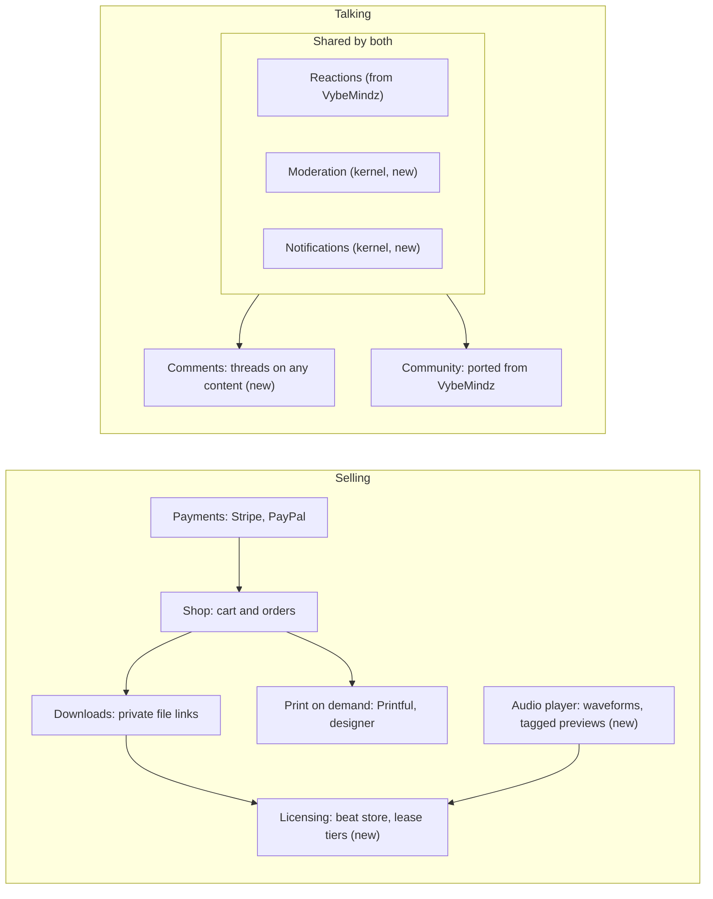

# Vibrant Mindz on DevKit: module plan

2026-11-12 · Mirrors the design doc "Vibrant Mindz on DevKit: module plan" (https://claude.ai/artifact/HsedU8JoNedu4ySBSU2Vrc).

The new Vibrant Mindz site needs 17 modules plus 2 new kernel services. Seven modules already exist in the owner's code, four are planned in VybeSite's notes, and six are new. Each one is generic, so every music, art or merch site after this one reuses it.

## 1. The brief

Vibrant Mindz is an audio-visual collective: music, poetry, paintings, video design, animation and graphic design. The new site replaces the current [vibrantmindz.com](https://www.vibrantmindz.com/), which runs on WordPress with Storefront and WooCommerce.

**What the current site has** (checked 2026-11-12)

- Pages for the music, poetry, rap battles, solo work by J Tone and N33kNow, a photo gallery, music credits, a blog and contact.
- The Vibrified Marketplace, which says CDs, vinyl, exclusive videos, paintings, poetry books and apparel are coming soon. Nothing is on sale yet.
- Music linked out to SoundCloud, Spotify, YouTube and Amazon instead of played on the page.

**The brief, as an agent would take it:** "The home of an audio-visual collective: its members' music, poetry, art and video, a store for beats, merch and art, and a community for fans." Visitors are fans, artists buying beats, and clients commissioning work. Visitors get accounts, and money changes hands.

## 2. Module map

The owner's five asks map to ten of these modules. The other seven cover what the current site already has, such as its pages, solo pages and gallery.

| Module | What it does on this site | Status | Comes from |
| --- | --- | --- | --- |
| `pages` | About, credits and other fixed pages | In your code | VybeSite pages |
| `blog` | News, poetry posts, rap battle write-ups | In your code | VybeSite blog |
| `embeds` | YouTube, SoundCloud, Spotify and Bandcamp players from a pasted link | In your code | VybeSite media embeds (#103) |
| `contact` | Contact and booking inquiries | In your code | VybeSite contact form |
| `campaigns` | Newsletter and release announcements | In your code | VybeSite campaigns |
| `community` | Discord-style chat for fans and members | In your code | VybeMindz |
| `reactions` | Emoji reactions, shared by community and comments | In your code | VybeMindz |
| `payments` | Stripe, then PayPal, with signed webhooks | Planned in VybeSite | VybeSite idea 4; APMonster billing |
| `shop` | Catalog, cart, checkout and orders: CDs, vinyl, books, paintings | Planned in VybeSite | VybeSite idea 4 |
| `downloads` | Digital delivery behind signed links; a Downloads page per customer | Planned in VybeSite | VybeSite idea 4; CarbonDSP storefront |
| `print-on-demand` | Custom apparel designer and Printful fulfilment | Planned in VybeSite | VybeSite idea 5 and its research |
| `licensing` | License tiers on digital products: the beat store | New | None yet |
| `audio-player` | One player for the whole site, with waveforms and tagged previews | New | Synkopate `useAudioPeaks` as a start |
| `comments` | Discussions under posts, beats, artwork and videos | New | Patterns from VybeMindz |
| `discography` | Albums, tracks, credits, lyrics and streaming links | New | None yet |
| `portfolio` | Paintings, graphic design, animation and video, by discipline | New | None yet |
| `roster` | A profile per member, gathering their work from every module | New | None yet |

The kernel also gains `notifications` and `moderation` (section 10).

## 3. How the pieces fit

The selling side is one chain: everything sold, from a vinyl record to a beat lease to a custom hoodie, goes through the same shop and payments. The talking side shares one core, so comments and the community don't each build their own reactions, moderation and notifications.

Arrows point from a module to the ones built on it. Build the chain left to right and the shared core first; each later module then needs only its own part.

## 4. Embeds and a site-wide audio player

Embeds are already built in VybeSite. What the site still lacks is a player for its own audio, which the beat store can't do without.

**`embeds`: lift it as it is.** A supported link alone on its line becomes the provider's player: YouTube, SoundCloud, Spotify and Bandcamp (`services/embeds.json`, `MediaEmbed.tsx`, contract `dev plans/contracts/media-embeds.md` in VybeSite). Each player is a sandboxed iframe on its provider's one host. It loads as it nears the screen, never autoplays, and keeps a linked caption, the backlink SoundCloud's and Spotify's terms ask for.

To make it a DevKit module:

- Expose it as a Markdown extension any module can use: blog, pages, comments, community messages and product pages.
- Add each provider's host to the CSP's `frame-src` only while that provider is switched on.
- Keep new providers to one entry in the list. Vimeo and TikTok are the obvious next two.

**`audio-player`: new.** Embeds can't sell beats, because previews have to be the site's own tagged files and the full file must never be reachable.

- One player for the whole site, docked at the bottom, that keeps playing across page changes and holds a queue.
- Waveforms come from peaks computed once by a job at upload, not in the browser. Synkopate's `useAudioPeaks` is a starting point.
- It streams only preview files: a tagged or shortened MP3 a job makes from the master. Masters never get a public address.
- Any module can hand it something to play: a discography track, a beat from licensing, a poem's reading.
- Play counts go to the site's analytics.

## 5. Shop, payments and downloads

These three are VybeSite's commerce plan (product idea 4), split up so a site can take payments without a shop, or run a shop with no digital goods.

| Module | Owns |
| --- | --- |
| `payments` | Provider adapters (Stripe Checkout first, PayPal next), keys sealed at rest, signed webhooks, refunds, Stripe Tax. Emits `payments.checkout.completed` and `payments.refund.issued` |
| `shop` | Products with variants such as size and color, stock (a painting has a stock of 1), shipping rates, cart, orders, receipts, the shop page and the cart settings |
| `downloads` | Entitlements: who may download which files, and how many times. Short-lived signed links into private object storage, a Downloads page per customer, and emailed links for guests |

**Rules carried over from the VybeSite plan**

- Card details never touch the site. Hosted checkout keeps the PCI scope as small as it gets.
- Guest checkout is on by default. A guest's purchases join their Downloads if they later sign up with that email.
- Files live in R2, never in Postgres. Private downloads use signed links. Print files use public, hard-to-guess links that last as long as the order.
- The dashboard gets a setup checklist: connect Stripe, add a product, publish the shop, each step checked live.
- APMonster's Stripe billing (Python, the closest match) and the CarbonDSP storefront (gated downloads, tiers) are ported as designs and logic, not files, since both run on other stacks.

**On this site:** CDs, vinyl, poetry books and paintings are `shop` products. Exclusive videos are paid `downloads` in v1 (Q2); member-only streams can follow with `memberships` (`docs/plans/module-roadmap.md`, wave 2c).

## 6. Beat and composition licensing

`licensing` is a generic module that sells usage rights to digital files. The beat store is its first use. Sample packs, plugins and stock video can reuse it later. The `beat-license-generator` skill holds the implementation detail.

**How it works**

- A licensable work, such as a beat or a composition, holds its files by format: a tagged preview, MP3, WAV, and a stems (trackouts) ZIP.
- The owner defines license tiers once and reuses them across works. Each tier sets the files delivered, the price and the rights granted.
- Checkout runs through `shop` and `payments`; delivery runs through `downloads`.
- Every purchase generates a license agreement: a PDF from the tier's template with the buyer, the work, the tier's terms, the date and a license id. It's emailed, kept in Downloads, and checkable by anyone at `/license/<id>`.

**Typical tiers.** The owner sets the real terms and prices, and a lawyer writes the templates.

| Tier | Files | Usual terms |
| --- | --- | --- |
| Basic lease | MP3 | Non-exclusive, with caps on streams and sales |
| Premium lease | MP3, WAV | Higher caps |
| Trackout lease | MP3, WAV, stems | Higher caps, for full mixing |
| Unlimited lease | All files | No caps, still non-exclusive |
| Exclusive | All files | Sole rights. The work leaves the store; earlier leases keep their terms |

**Compositions and sync.** Film, ad and game uses need custom terms, so a composition can be set to "request a license" instead of a fixed price. That means a form, the owner's quote, then a one-off checkout link.

**Store features**

- Filters for BPM, key, genre and mood.
- The `audio-player` with tagged previews.
- An optional free download in exchange for an email, tied to `campaigns`.
- The credit line each license requires ("prod. by") printed on the agreement.

**Splits within the collective.** Each work can list its contributors and their shares. In v1 the module reports what each person earned, and payouts stay manual (Q5).

## 7. Custom apparel designer (print on demand)

This is already fully designed in VybeSite's notes: product idea 5 and its research report. DevKit splits it in two, so other sites can use the fulfilment without the designer. The `printful-v2-adapter` skill holds the implementation detail.

**`print-on-demand`, the capability**

- Provider-agnostic adapters, with Printful's v2 API first.
- The provider's catalog is cached, never proxied live.
- A print-file renderer (Pillow) draws the whole print area at the provider's DPI. Printful takes no rotation, so rendering it ourselves also makes switching providers cheap.
- A draft order is created when payment succeeds, then confirmed once its costs calculate. It's idempotent by external id, with a retry queue kept under 120 requests a minute.
- Signed webhooks bring status and tracking back.

**The apparel designer, its web binding**

- The customer picks a garment from the owner's curated list, then artwork from the owner's gallery.
- They place it on front, back or sleeve with react-konva, inside the real print area. The design is stored as placement, center, scale and rotation.
- The live preview is drawn in the browser, with a warning when the art's resolution is too low.
- One photoreal mockup is made at checkout, since Printful's mockup generator allows only 2 to 10 tasks a minute.

**The money.** The customer pays the owner full retail, and Printful separately debits the owner's prepaid Printful wallet. No Stripe Connect.

**Before the first sale**

- The owner is the seller of record and owes sales tax. Printful also charges the owner tax unless a resale certificate is on file first.
- Returns cover misprints only, and chargebacks fall on the owner.
- Every gallery image needs commercial rights for merchandise. The gallery extends the media library with larger size limits and a licensing field.

The provider facts come from the October research and a check of Printful's v2 docs on 2026-11-12; v2 is still labelled beta. Re-check them before building.

## 8. Community: porting VybeMindz

VybeMindz is already this module. The work is moving it onto the kernel, not building it.

**What VybeMindz already has** (from its routers): channels, messages, DMs with optional end-to-end encryption, reactions, custom emojis, GIFs, polls, bookmarks, search, uploads, roles, invites, and an admin with a moderation audit log, all over WebSockets. It's live on Railway with 323 backend and 327 frontend tests.

**The port**

- Its own sign-in moves to kernel auth (spec section 14), and its JWT revocation to kernel sessions.
- Its Tailwind 3 and Zustand UI moves to theme tokens and the kernel UI kit.
- Reactions become their own module, so `comments` can share them.
- Moderation and notifications move into the kernel (section 10).
- Realtime runs through the kernel: WebSockets, plus Redis pub/sub once a site runs more than one worker.
- End-to-end encrypted DMs stay as a setting, off by default.

**Engagement features to confirm or add during the port**

- @mentions and replies, with notifications.
- Threads under a message, pinned messages, and unread counts.
- Presence and typing indicators.
- Member profiles with roles and badges, such as artist, fan and supporter, linked to `roster`.
- An announcements channel that posts by itself from events: a new post, a new beat, a new drop.
- Embeds inside messages.
- For moderators: report a message, slow mode and timeouts.

**Later:** voice and video rooms, borrowed from darkha.us's media stack.

## 9. Comments on blog posts and any other content

`comments` is a generic discussions module: any module can attach a thread to any item, so the same code serves blog posts, beats, artwork, videos and poems.

- **Attaching.** A thread is keyed by module and item id. A module drops `<Comments target={...} />` on its page and lists `comments` under `requires`.
- **Shape.** Replies two levels deep, reactions from the shared module, @mentions, edits for 15 minutes, sorting by top or newest. Deleting a comment that has replies leaves a placeholder.
- **Who can post.** Signed-in members with a verified email (spec 14.7), and guests too (Q4). Every guest comment waits for staff approval before anyone else sees it.
- **Spam and abuse.** A member's first comment waits for approval, as every guest comment does. Until `bot-shield` arrives (roadmap wave 1), approval, rate limits and the text filters are what stop spam. Links are limited and marked `rel="ugc nofollow"`. VybeSite's contact filter and blocklist screen text, rate limits apply, and a report button feeds the kernel's moderation queue.
- **Notifications.** Replies and mentions arrive in the site and by email, with an unsubscribe per thread.
- **SEO.** Approved comments join the page's server copy, so crawlers that don't run JavaScript see the discussion too.
- **Bridge to the community (optional).** A setting posts each new blog post into a community channel, with links both ways.

## 10. Changes this needs in the DevKit spec

Five changes, none of which touch the locked decisions. All five were applied to the spec on 2026-11-12 and are listed in its change log.

1. **The kernel gains `notifications`:** in-site and email, per-person preferences, and one-click unsubscribe. Comments, community, orders and licenses all need it.
2. **The kernel gains `moderation`:** reports, a staff queue, word and link filters, and actions (hide, delete, time out, ban), all audited. Comments, community and any future forum or reviews share it.
3. **Shared UI between modules:** a module's web binding MAY export components in a `public.ts`, for modules that list it under `requires`. This is how a blog post shows `<Comments>`.
4. **Object storage rules:** private files only behind signed links; files a provider must fetch on public, unguessable links that expire with the job.
5. **CSP growth:** each embed provider and payment host is added only while its module or setting is on, each with a test.

Blog, chat and payments, the three modules the spec uses to validate v0.1, are all on this site. So the Vibrant Mindz build can be the validation itself rather than a separate exercise.

## 11. Build order for the Vibrant Mindz site

The site launches once the shop works, as decided for VybeSite on 11 October. Each step is also a DevKit milestone, so the site and the framework grow together.

1. **Kernel**, plus `pages`, `blog`, `embeds`, `contact` and `campaigns`, lifted from VybeSite.
2. **`comments` and `reactions`**, then `discography`, `portfolio` and `roster`, so the content side is complete.
3. **`community`**, ported from VybeMindz.
4. **`payments`, `shop` and `downloads`.** Blog, chat and payments now all exist, so this is where DevKit's v1.0 gate is checked. **The new site launches here.**
5. **`licensing` and `audio-player`:** the beat store opens.
6. **`print-on-demand`:** the apparel designer opens.

## 12. The owner's answers (2026-11-13)

- [x] **Q1** Beat license tiers: when the `licensing` module starts, Claude drafts a starting table (names, files, caps, prices) from common lease tiers for the owner to edit. A lawyer then writes the agreement templates.
- [x] **Q2** Exclusive videos: paid downloads in v1. Member-only streams can follow with `memberships`.
- [x] **Q3** Community sign-up: open to fans.
- [x] **Q4** Comments: guests too, with approval (not the default, members only).
- [x] **Q5** Collective splits: reports only in v1; payouts stay manual.
- [x] **Q6** The store keeps the name Vibrified Marketplace.

## Sources

- [vibrantmindz.com](https://www.vibrantmindz.com/), the current site, read 2026-11-12
- `C:\DEV\VybeSite\dev plans\2026-10-11-product-ideas.md`: page manager, embeds, commerce, and the apparel designer with its research
- `C:\DEV\VybeSite\dev plans\2026-11-08-embeds-research.md` and `vybesite\backend\app\services\embeds.json`
- `C:\DEV\VybeMindz\backend\app\routers\`: the community's feature set
- `SPEC.md` in this repo
